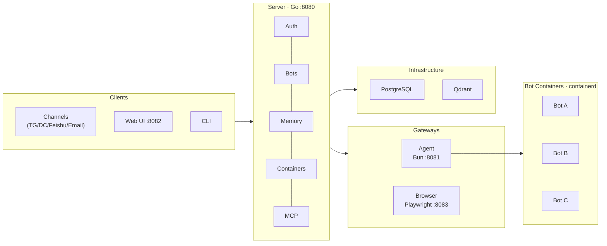
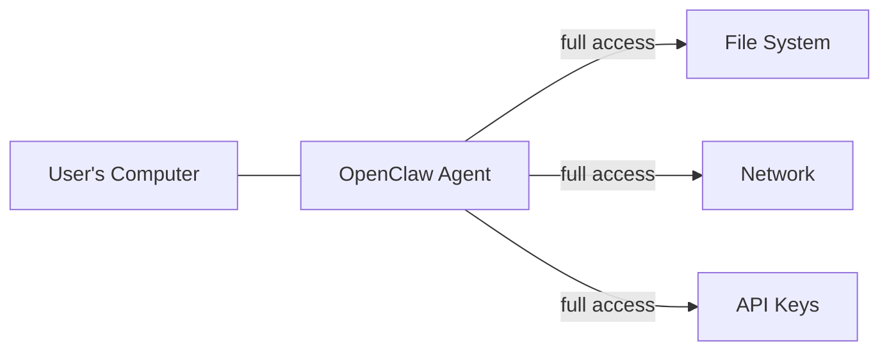
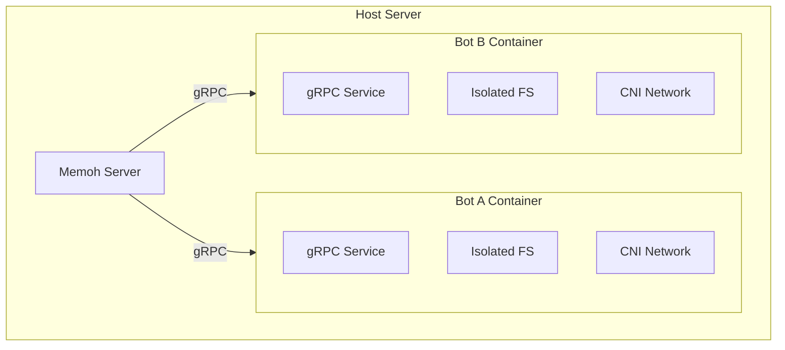
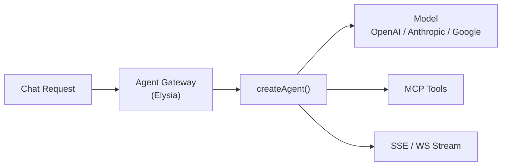
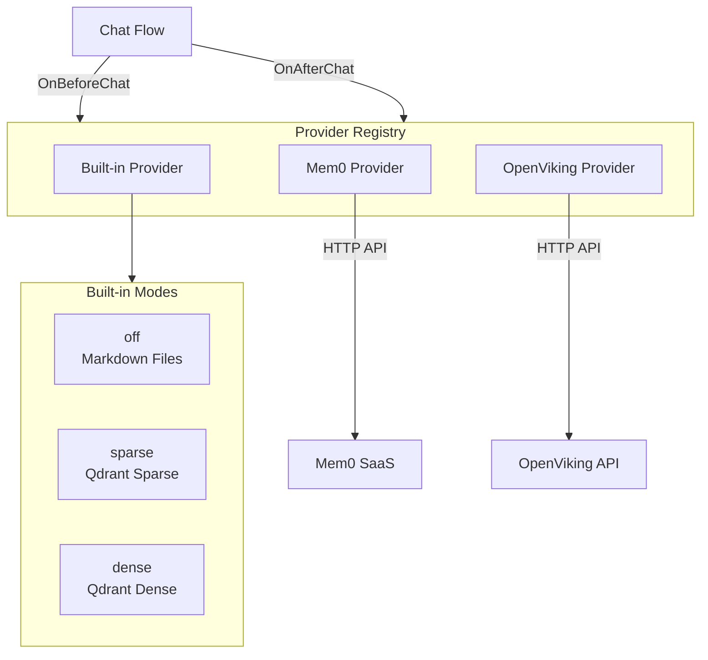
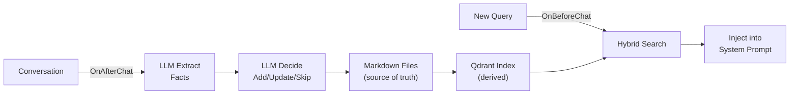
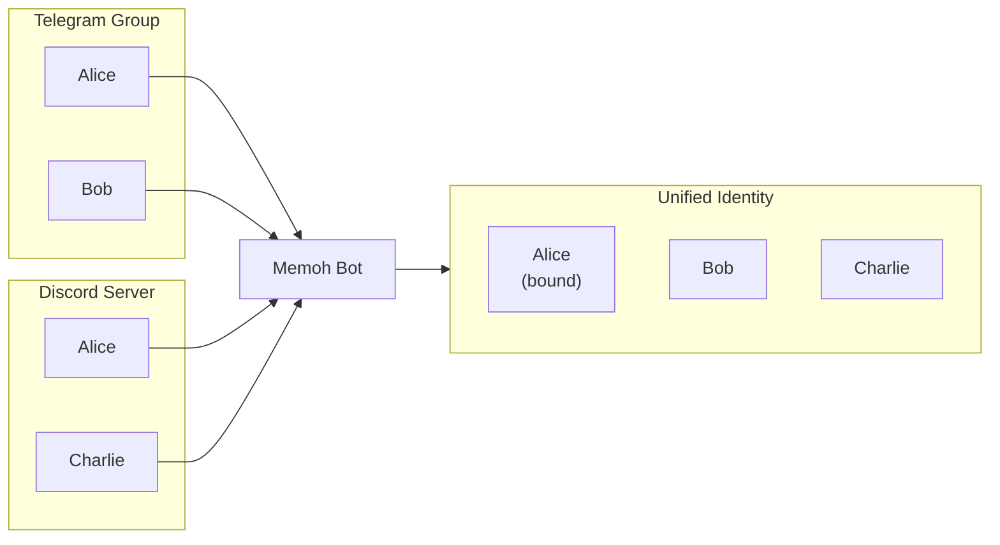

<div flex flex-col items-center gap-4 relative>
  
  <h1 text-4xl font-bold>Memoh</h1>
  <div text-xl op-80>Containerized AI Agent System</div>
  <div text-sm op-50 mt-2>Multi-Member · Structured Long-Memory · Containerized AI Agent Platform</div>
</div>

<div abs-bl m-6 text-sm op-60>
  Acbox / 小箱子
</div>

<div abs-br m-6 text-sm>
  <a href="https://github.com/memohai/Memoh" target="_blank" class="slidev-icon-btn !border-none">
    <carbon:logo-github />
  </a>
</div>

<!--
大家好我是 Acbox，今天分享 Memoh——一个容器化的 AI Agent 系统平台。
-->

---
layout: intro
class: px-35
glowSeed: 205
---

<div flex items-center gap-6>
  <div
    v-click="1"
    :class="$clicks < 1 ? 'translate-x--10 op-0' : 'translate-x-0 op-100'"
    flex flex-col items-start transition duration-500 ease-in-out min-w-55
  >
    
    <span font-semibold text-3xl>Acbox / 小箱子</span>
    <div mt-2>
      <div op-70>Suzhou / Shenzhen, China</div>
      <div text-sm flex items-center gap-2 mt-3>
        <carbon:logo-github />
        <a href="https://github.com/sheepbox8646" target="_blank"><span underline decoration-dashed font-mono decoration-zinc-300>sheepbox8646</span></a>
      </div>
      <div text-sm flex items-center gap-2 mt-1>
        <carbon:logo-twitter />
        <span font-mono op-70>@AcboxLiu</span>
      </div>
    </div>
  </div>
  <div flex-1 />
  <div flex flex-col gap-6>
    <div v-click="2">
      <div mb-3 text-zinc-400 text-sm>开源项目</div>
      <div
        flex flex-wrap items-start content-start gap-3 transition duration-500 ease-in-out
        :class="$clicks < 2 ? 'translate-y-5 op-0' : 'translate-y-0 op-100'"
      >
        <div flex items-center gap-2 text-lg border="2 solid indigo-800/50" rounded-lg bg="indigo-900/10" backdrop-blur-sm px-3 py-1.5>
          
          <div>Memoh <span text-xs op-50>1k+</span></div>
        </div>
        <div flex items-center gap-2 text-lg border="2 solid white/5" rounded-lg bg="white/5" backdrop-blur-sm px-3 py-1.5>
          
          <div>ChatTutor <span text-xs op-50>974</span></div>
        </div>
      </div>
    </div>
    <div v-click="3">
      <div mb-3 text-zinc-400 text-sm>组织</div>
      <div
        flex flex-wrap items-start content-start gap-3 transition duration-500 ease-in-out
        :class="$clicks < 3 ? 'translate-y-5 op-0' : 'translate-y-0 op-100'"
      >
        <div flex items-center gap-2 text-lg>
          
          <div>Memoh AI</div>
        </div>
        <div flex items-center gap-2 text-lg>
          
          <div>HugeCatLab</div>
        </div>
      </div>
    </div>
  </div>
</div>

<!--
先简单自我介绍。我是 Acbox，也叫小箱子，坐标苏州/深圳。主要做 Memoh、ChatTutor、xsai、newcar 这些开源项目。今天主要分享的是 Memoh。
-->

---
glowSeed: 120
---

# The OpenClaw Phenomenon

<div mt-8>
  <div
    v-click="1"
    :class="$clicks < 1 ? 'translate-y-8 op-0' : 'translate-y-0 op-100'"
    transition duration-500 ease-in-out
  >

  - 2026 年 1 月底病毒式传播，GitHub **25 万+ stars**

  </div>

  <div
    v-click="2"
    :class="$clicks < 2 ? 'translate-y-8 op-0' : 'translate-y-0 op-100'"
    transition duration-500 ease-in-out
  >

  - Jensen Huang："**史上最重要软件发布**"

  </div>

  <div
    v-click="3"
    :class="$clicks < 3 ? 'translate-y-8 op-0' : 'translate-y-0 op-100'"
    transition duration-500 ease-in-out
  >

  - 中国"小龙虾热"兴起 — 装机服务、政府补贴、企业试点

  </div>

  <div
    v-click="4"
    :class="$clicks < 4 ? 'translate-y-8 op-0' : 'translate-y-0 op-100'"
    transition duration-500 ease-in-out
  >

  - AI Agent 从概念走向大众的**分水岭**

  </div>
</div>

<!--
OpenClaw 在 1 月底爆火，GitHub 星标飙到 25 万。Jensen Huang 称其为"史上最重要软件发布"。中国掀起小龙虾热——各地涌现装机服务和企业试点。这不只是一个开源项目的流行，这是 Agent 走向大众的分水岭。
-->

---
glowSeed: 340
---

# But... Security Concerns

<div mt-6>
  <div
    v-click="1"
    :class="$clicks < 1 ? 'translate-x--10 op-0' : 'translate-x-0 op-100'"
    transition duration-500 ease-in-out text-red-400
  >

  - **CVE-2026-25253**：一键 RCE 漏洞 — 恶意网站可劫持本地代理

  </div>

  <div
    v-click="2"
    :class="$clicks < 2 ? 'translate-x--10 op-0' : 'translate-x-0 op-100'"
    transition duration-500 ease-in-out text-red-400
  >

  - **ClawHub 恶意技能** + 暴露实例泄露 API 密钥

  </div>

  <div
    v-click="3"
    :class="$clicks < 3 ? 'translate-x--10 op-0' : 'translate-x-0 op-100'"
    transition duration-500 ease-in-out text-red-400
  >

  - 政府警告国企禁用，科技公司内部限制使用

  </div>
</div>

<div
  v-click="4"
  :class="$clicks < 4 ? 'translate-y-5 op-0' : 'translate-y-0 op-100'"
  transition duration-500 ease-in-out
  mt-10 p-4 rounded-lg text-center text-lg
  border="2 solid red-800/50" bg="red-900/10" backdrop-blur-sm
>
  <strong>"Agent 直接操作你的电脑，安全边界在哪里？"</strong>
</div>

<!--
但热潮之下暗流涌动。一键 RCE 漏洞——恶意网站可以劫持你的本地代理。ClawHub 出现恶意技能，API 密钥泄露。政府也开始警告国企和银行禁用。这引出一个根本问题——Agent 直接操作你的电脑，安全边界在哪里？
-->

---
glowSeed: 180
---

# Two Routes

<div mt-4 w="55%">

| | OpenClaw | Memoh |
|---|---------|-------|
| 定位 | Personal Assistant | Agent Platform |
| 运行环境 | 你的电脑 | 独立容器 |
| 安全模型 | 信任 Agent | 隔离 Agent |
| 用户 | 单人 | 多用户多租户 |
| 配置 | CLI / 配置文件 | WebUI |

</div>

<div absolute right-8 top-32 w-72>
  
  <p text-xs op-50 text-center mt-2>Memoh Web UI — Chat with Bots</p>
</div>

<!--
OpenClaw 是个人助手，运行在你的电脑上，本质上信任 Agent。Memoh 更像一个平台，每个 Bot 运行在独立容器中，从一开始就隔离 Agent。一个是单人工具，一个是多用户多租户系统。
-->

---
layout: center
class: text-center
glowSeed: 405
---

<div
  absolute text-5xl font-bold
  :class="$clicks < 1 ? 'text-white scale-100' : 'translate-y--18 scale-40 text-white/30'"
  transition duration-500 ease-in-out
>
  <span>Design Philosophy</span>
</div>

<div flex flex-col items-center>
  <v-clicks>
    <div mt-4>
      <div text-3xl font-bold leading-relaxed>
        "Don't let AI operate <span text-red-400>YOUR</span> computer.<br/>
        Give AI <span text-green-400>ITS OWN</span> computer."
      </div>
    </div>
  </v-clicks>
</div>

<div
  v-click="2"
  :class="$clicks < 2 ? 'translate-y-5 op-0' : 'translate-y-0 op-100'"
  transition duration-500 ease-in-out
  flex gap-4 justify-center mt-10
>
  <span px-4 py-2 rounded-full border="2 solid blue-800/50" bg="blue-900/10" backdrop-blur-sm text-blue-300>Container Isolation</span>
  <span px-4 py-2 rounded-full border="2 solid green-800/50" bg="green-900/10" backdrop-blur-sm text-green-300>Multi-Tenant</span>
  <span px-4 py-2 rounded-full border="2 solid purple-800/50" bg="purple-900/10" backdrop-blur-sm text-purple-300>Production-Ready</span>
</div>

<!--
我们的核心哲学——不让 AI 操作你的电脑，给 AI 它自己的电脑。每个 Bot 独立容器，即使失控也只在沙箱里。从第一天起就面向稳定可落地的服务设计。
-->

---
glowSeed: 512
---

# Platform Deployment

<div grid="~ cols-2" gap-8 mt-6>
  <div
    v-click="1"
    :class="$clicks < 1 ? 'translate-x--10 op-0' : 'translate-x-0 op-100'"
    transition duration-500 ease-in-out
    border="2 solid blue-800/50" rounded-lg bg="blue-900/10" backdrop-blur-sm p-5
  >
    <div font-semibold text-blue-300 text-xl mb-3>Private Deploy</div>
    <div text-sm space-y-2>
      <div>公司内网 / 自有服务器</div>
      <div>数据完全自主可控</div>
      <div>一键安装：</div>
    </div>
    <div mt-3>

```bash
curl -fsSL https://memoh.sh | sudo sh
```

  </div>
  </div>

  <div
    v-click="2"
    :class="$clicks < 2 ? 'translate-x-10 op-0' : 'translate-x-0 op-100'"
    transition duration-500 ease-in-out
    border="2 solid green-800/50" rounded-lg bg="green-900/10" backdrop-blur-sm p-5
  >
    <div font-semibold text-green-300 text-xl mb-3>SaaS <span text-xs font-normal op-60 bg="green-700/30" px-2 py-0.5 rounded-full ml-2>Coming Soon</span></div>
    <div text-sm space-y-2>
      <div>托管服务，低门槛上手</div>
      <div>按需扩展，持续订阅</div>
      <div>多租户：角色权限控制</div>
    </div>
    <div mt-6 p-3 bg="white/5" rounded text-center text-sm>
      一套代码，两种交付
    </div>
  </div>
</div>

<!--
Memoh 是一个平台不是客户端。私有部署到公司内网，数据完全自主可控，curl 一行命令搞定。也可以做 SaaS 托管服务。一套代码两种交付方式，这是跟 OpenClaw 个人工具的本质区别。

技术细节补充：那个 curl 一行命令背后是 install.sh 脚本——先检查 Docker 是否安装，拉取最新版本号，然后交互式配置 admin 密码、JWT secret、选择是否启用 Qdrant 和 Browser，生成 config.toml，最后启动 docker compose。Docker Compose 支持 profiles——qdrant profile 启用向量数据库、browser profile 启用 Playwright 浏览器自动化、openviking profile 启用自托管记忆服务，按需组合。中国大陆用户在 config.toml 里设置 registry 为 memoh.cn，再加载 docker-compose.cn.yml 覆盖镜像源就行。生产环境的 Dockerfile.server 是多阶段构建——Go 编译阶段、MCP rootfs 构建阶段、OCI 镜像导出阶段，最终镜像包含 memoh 二进制、containerd 运行时和 CNI 网络插件，一个容器跑整个 Server。
-->

---
glowSeed: 275
---

# Origin Story

<div mt-6 space-y-4>
  <div
    v-click="1"
    :class="$clicks < 1 ? 'translate-y-8 op-0' : 'translate-y-0 op-100'"
    transition duration-500 ease-in-out
    border="2 solid white/5" rounded-lg bg="white/5" backdrop-blur-sm px-4 py-3
  >
    <span text-indigo-300 font-semibold>2025 年底</span> — Telegram 水群，看到群友做的 bot：分清群友、长期记忆、24h 上下文
  </div>

  <div
    v-click="2"
    :class="$clicks < 2 ? 'translate-y-8 op-0' : 'translate-y-0 op-100'"
    transition duration-500 ease-in-out
    border="2 solid white/5" rounded-lg bg="white/5" backdrop-blur-sm px-4 py-3
  >
    <span text-indigo-300 font-semibold>设计 Memoh</span> — Agent Container + 定时任务 + Telegram 支持 + WebUI
  </div>

  <div
    v-click="3"
    :class="$clicks < 3 ? 'translate-y-8 op-0' : 'translate-y-0 op-100'"
    transition duration-500 ease-in-out
    border="2 solid white/5" rounded-lg bg="white/5" backdrop-blur-sm px-4 py-3
  >
    <span text-indigo-300 font-semibold>2026.1 月底</span> — OpenClaw 爆火，吸收设计思路，但架构路线从一开始就不同
  </div>

  <div
    v-click="4"
    :class="$clicks < 4 ? 'translate-y-8 op-0' : 'translate-y-0 op-100'"
    transition duration-500 ease-in-out
    border="2 solid white/5" rounded-lg bg="white/5" backdrop-blur-sm px-4 py-3
  >
    <span text-indigo-300 font-semibold>2026.2 月</span> — 密集发布 features，社区反响不错
  </div>
</div>

<div
  v-click="5"
  :class="$clicks < 5 ? 'translate-y-5 op-0' : 'translate-y-0 op-100'"
  transition duration-500 ease-in-out
  mt-6 p-4 border="2 solid indigo-800/50" rounded-lg bg="indigo-900/10" backdrop-blur-sm text-center
>
  <strong>"出发点和架构路线从一开始就不同"</strong>
</div>

<!--
去年年底在 Telegram 水群看到群友做了一个 bot，能分清群里的人、有长期记忆、加载 24 小时上下文。我就开始设计 Memoh，一开始就在研究 Agent Container。一月底 OpenClaw 爆火，我吸收了大量设计思路，但 Memoh 不是仿品——出发点和架构路线从一开始就不同。
-->

---
glowSeed: 150
---

# Architecture



<!--
Memoh 由四个核心服务组成——Go 后端做管控面，Bun/Elysia 做推理面，Vue 3 做前端，Playwright 做浏览器自动化。两层通过 HTTP 通信，职责清晰。

技术细节补充：Go 后端用 Echo 框架做 HTTP，Uber FX 做依赖注入，pgx/v5 驱动 PostgreSQL，sqlc 做 SQL 到 Go 的代码生成——改 SQL 文件跑一条命令就能生成类型安全的 Go 代码。Agent Gateway 用 Bun 运行时加 Elysia 框架，比传统 Node.js Express 快很多。四个服务各自独立进程：Server :8080、Agent :8081、Web :8082、Browser :8083。开发环境用 devenv/ 下的 docker-compose 编排所有服务加 PostgreSQL 和 Qdrant，生产环境用 docker/ 下的多阶段构建 Dockerfile，一个镜像包含 Go 二进制、containerd 运行时和 CNI 网络插件。
-->

---
glowSeed: 388
---

# Go + TypeScript: Best of Both

<div grid="~ cols-2" gap-6 mt-6>
  <div
    v-click="1"
    :class="$clicks < 1 ? 'translate-x--10 op-0' : 'translate-x-0 op-100'"
    transition duration-500 ease-in-out
    border="2 solid cyan-800/50" rounded-lg overflow-hidden bg="cyan-900/10" backdrop-blur-sm flex flex-col h-full
  >
    <div flex flex-col justify-center items-center bg="cyan-800/20" px-3 py-4 text-cyan-200>
      <div i-mdi:language-go text-5xl mb-2 />
      <div font-semibold text-lg>Go — Control Plane</div>
    </div>
    <div px-4 py-3 text-sm space-y-1>
      <div>容器编排</div>
      <div>数据库 & 认证</div>
      <div>渠道路由</div>
      <div op-70>性能好、并发强</div>
    </div>
  </div>

  <div
    v-click="2"
    :class="$clicks < 2 ? 'translate-x-10 op-0' : 'translate-x-0 op-100'"
    transition duration-500 ease-in-out
    border="2 solid yellow-800/50" rounded-lg overflow-hidden bg="yellow-900/10" backdrop-blur-sm flex flex-col h-full
  >
    <div flex flex-col justify-center items-center bg="yellow-800/20" px-3 py-4 text-yellow-200>
      <div i-mdi:language-typescript text-5xl mb-2 />
      <div font-semibold text-lg>TypeScript — Inference Plane</div>
    </div>
    <div px-4 py-3 text-sm space-y-1>
      <div>Vercel AI SDK</div>
      <div>模型适配（OpenAI / Anthropic / Google）</div>
      <div>工具调用 & 流式输出</div>
      <div op-70>AI 生态成熟</div>
    </div>
  </div>
</div>

<div
  v-click="3"
  :class="$clicks < 3 ? 'op-0' : 'op-100'"
  transition duration-500 ease-in-out
  mt-4
>
  
  <p text-xs op-50 text-center mt-1>Provider & Model Configuration</p>
</div>

<!--
为什么分两层？Go 适合长期运行的服务——容器编排、数据库、认证。TypeScript 的 AI SDK 生态成熟——模型适配、工具调用、流式输出都是现成的。各取所长。

技术细节补充：Go 侧关键依赖——containerd/v2 做容器编排、pgx/v5 做数据库驱动、Qdrant Go client 做向量搜索、Telegram/Discord/飞书原生 SDK 做渠道适配、Cobra 做 CLI、modelcontextprotocol/go-sdk 做 MCP 协议实现。TypeScript 侧——Vercel AI SDK 统一了 OpenAI、Anthropic、Google 三家模型的 streamText 和 generateText 接口，不用为每家写适配代码，切换模型只需改一个 clientType 配置。整个 TypeScript 侧是 pnpm monorepo 结构：packages/agent 是核心 Agent 库、packages/sdk 从 OpenAPI spec 自动生成、packages/ui 是共享 Vue 组件库，apps 下面分 agent、web、browser 三个应用。改了后端 API 就跑 swagger-generate 再跑 sdk-generate，前端 SDK 自动更新。
-->

---
class: flex justify-center items-center gap-20 px-40 text-xl
glowSeed: 600
---

<div
  absolute text-5xl
  :class="$clicks < 1 ? 'text-white' : 'translate-y--18 scale-40 text-white/30'"
  transition duration-500 ease-in-out
>
  <span>The Security Problem</span>
</div>

<div flex flex-col items-center>
  <v-clicks>
    <div mt-4>



  <div mt-4 text-center text-red-400 text-lg font-bold>
    Agent 的能力边界 = 用户的能力边界，没有隔离层
  </div>
    </div>
  </v-clicks>
</div>

<!--
OpenClaw 的 Agent 直接运行在用户电脑上，拥有用户所有权限。文件系统、网络、API 密钥全部 full access。恶意提示注入就可能导致删除文件、泄露密钥。本质问题是没有隔离层。
-->

---
glowSeed: 450
---

# Container Isolation



<div mt-4 grid="~ cols-2" gap-3>
  <div
    v-click="1"
    :class="$clicks < 1 ? 'translate-y-5 op-0' : 'translate-y-0 op-100'"
    transition duration-500 ease-in-out
    border="2 solid white/5" rounded-lg bg="white/5" backdrop-blur-sm px-3 py-2 text-sm
  >
    <div i-carbon:container-software text-green-300 text-sm mr-1 inline-block /> <strong>Containerd</strong> — 不是 Docker，更轻量
  </div>
  <div
    v-click="2"
    :class="$clicks < 2 ? 'translate-y-5 op-0' : 'translate-y-0 op-100'"
    transition duration-500 ease-in-out
    border="2 solid white/5" rounded-lg bg="white/5" backdrop-blur-sm px-3 py-2 text-sm
  >
    <div i-carbon:terminal text-blue-300 text-sm mr-1 inline-block /> 每个容器内 <strong>gRPC</strong> 服务：ReadFile / WriteFile / Exec
  </div>
  <div
    v-click="3"
    :class="$clicks < 3 ? 'translate-y-5 op-0' : 'translate-y-0 op-100'"
    transition duration-500 ease-in-out
    border="2 solid amber-800/50" rounded-lg bg="amber-900/10" backdrop-blur-sm px-3 py-2 text-sm
  >
    <div i-carbon:save text-amber-300 text-sm mr-1 inline-block /> <strong>快照 & 版本化回滚</strong>：每次变更可创建快照，出问题一键回退到任意版本
  </div>
  <div
    v-click="4"
    :class="$clicks < 4 ? 'translate-y-5 op-0' : 'translate-y-0 op-100'"
    transition duration-500 ease-in-out
    border="2 solid white/5" rounded-lg bg="white/5" backdrop-blur-sm px-3 py-2 text-sm
  >
    <div i-carbon:network-4 text-purple-300 text-sm mr-1 inline-block /> <strong>CNI 网络隔离</strong>：控制容器网络访问范围
  </div>
</div>

<div
  v-click="5"
  :class="$clicks < 5 ? 'translate-y-5 op-0' : 'translate-y-0 op-100'"
  transition duration-500 ease-in-out
  mt-3 p-3 border="2 solid amber-800/50" rounded-lg bg="amber-900/10" backdrop-blur-sm text-sm
>
  <div flex items-center gap-6 justify-center>
    <div flex items-center gap-1.5>
      <div i-carbon:data-backup text-amber-300 />
      <span><strong>Export</strong> / <strong>Import</strong> — tar.gz 备份恢复</span>
    </div>
    <div flex items-center gap-1.5>
      <div i-carbon:reset text-amber-300 />
      <span><strong>Rollback</strong> — 按版本号精确回退</span>
    </div>
    <div flex items-center gap-1.5>
      <div i-carbon:flow text-amber-300 />
      <span><strong>Lineage</strong> — 快照链追踪</span>
    </div>
  </div>
</div>

<!--
Memoh 的回答是容器隔离。每个 Bot 一个 Containerd 容器——比 Docker 更轻量，Docker 底层也是用的 Containerd。容器内跑 gRPC 服务，主服务通过 gRPC 远程调用。Agent 永远不接触宿主机。CNI 网络隔离可以控制访问范围。

重点讲快照和回滚——这是容器化 Agent 最大的优势之一。传统 Agent 跑在你电脑上，装错了东西、改坏了配置，你只能手动修。Memoh 的每个容器支持完整的快照和版本化管理。具体来说有三层能力：第一，快照创建——调用 CreateSnapshot API 就能把当前容器的文件系统状态冻结成一个不可变快照，containerd 底层用 overlayfs 做 copy-on-write，快照几乎是瞬时的、不占额外空间。第二，版本化回滚——每个快照关联一个递增版本号，存在 PostgreSQL 的 snapshots 和 container_versions 两张表里。回滚时指定版本号调用 RollbackSnapshot API，系统会沿着快照链（snapshot lineage）找到目标快照，停止当前容器，从那个快照重新创建容器并启动。整个过程是原子的，Bot 的人格文件、技能、记忆文件全部回到那个时间点的状态。第三，数据备份恢复——Export API 把容器的 /data 目录打包成 tar.gz 下载到本地，Import API 上传 tar.gz 恢复，可以跨服务器迁移 Bot。还有个 RestorePreservedData API 用于从容器重建时恢复之前保存的数据。

这意味着什么？Bot 自己写了一段有 bug 的代码搞崩了环境？回滚到上一个版本。想试验一个危险操作？先建快照再操作，不行就回退。要把 Bot 从测试服务器迁移到生产环境？Export 再 Import。这是给 AI 自己的电脑加了一个"时光机"。

技术细节补充：底层使用 containerd v2 client，默认连接 /run/containerd/containerd.sock，通过 ClientFactory 工厂模式创建客户端。代码里有个 ProvideService 函数，根据 backend 参数自动选择——Linux 上用 containerd，macOS 上自动切换到 Apple Virtualization 后端，通过 runtime.GOOS 检测，实验性支持 macOS 26+。每个容器内跑一个 MCP gRPC 服务监听 9090 端口，实现 ContainerServiceServer 接口，支持 ReadFile、WriteFile、Exec 等 RPC 调用。容器首次启动时 initDataDir 函数会从 /opt/mcp-template 目录 seed 模板文件到 /data/——包括 SOUL.md、IDENTITY.md、TOOLS.md 等，这就是 Bot 的初始人格定义。快照链追踪用 snapshotLineage 函数实现，从当前容器的 snapshotKey 出发沿 parent 字段遍历整条链，在 WebUI 上可以看到完整的版本历史树。
-->

---
glowSeed: 310
---

# MCP — Controlled Tool System

<div grid="~ cols-3" gap-3 mt-6>

<v-clicks>

  <div border="2 solid blue-800/50" rounded-lg overflow-hidden bg="blue-900/10" backdrop-blur-sm>
    <div flex items-center bg="blue-800/20" px-3 py-2>
      <div i-carbon:container-software text-blue-300 text-sm mr-2 />
      <div font-semibold>Container</div>
    </div>
    <div px-3 py-2 text-sm op-80>ReadFile · WriteFile · Exec</div>
  </div>

  <div border="2 solid green-800/50" rounded-lg overflow-hidden bg="green-900/10" backdrop-blur-sm>
    <div flex items-center bg="green-800/20" px-3 py-2>
      <div i-carbon:data-base text-green-300 text-sm mr-2 />
      <div font-semibold>Memory</div>
    </div>
    <div px-3 py-2 text-sm op-80>search_memory</div>
  </div>

  <div border="2 solid purple-800/50" rounded-lg overflow-hidden bg="purple-900/10" backdrop-blur-sm>
    <div flex items-center bg="purple-800/20" px-3 py-2>
      <div i-carbon:chat text-purple-300 text-sm mr-2 />
      <div font-semibold>Communication</div>
    </div>
    <div px-3 py-2 text-sm op-80>send_message · inbox</div>
  </div>

  <div border="2 solid yellow-800/50" rounded-lg overflow-hidden bg="yellow-900/10" backdrop-blur-sm>
    <div flex items-center bg="yellow-800/20" px-3 py-2>
      <div i-carbon:time text-yellow-300 text-sm mr-2 />
      <div font-semibold>Automation</div>
    </div>
    <div px-3 py-2 text-sm op-80>schedule · heartbeat</div>
  </div>

  <div border="2 solid red-800/50" rounded-lg overflow-hidden bg="red-900/10" backdrop-blur-sm>
    <div flex items-center bg="red-800/20" px-3 py-2>
      <div i-carbon:earth text-red-300 text-sm mr-2 />
      <div font-semibold>Web</div>
    </div>
    <div px-3 py-2 text-sm op-80>search · fetch_url · browser</div>
  </div>

  <div border="2 solid cyan-800/50" rounded-lg overflow-hidden bg="cyan-900/10" backdrop-blur-sm>
    <div flex items-center bg="cyan-800/20" px-3 py-2>
      <div i-carbon:plug text-cyan-300 text-sm mr-2 />
      <div font-semibold>Extension</div>
    </div>
    <div px-3 py-2 text-sm op-80>subagent · skill · external MCP</div>
  </div>

</v-clicks>

</div>

<div
  v-click="7"
  :class="$clicks < 7 ? 'translate-y-5 op-0' : 'translate-y-0 op-100'"
  transition duration-500 ease-in-out
  mt-6 flex gap-4 items-center justify-center
>
  <div p-3 border="2 solid red-800/50" bg="red-900/10" backdrop-blur-sm rounded text-center text-sm>
    <div text-red-400 font-bold>OpenClaw ClawHub</div>
    <div op-70>不受控 — 你的电脑上</div>
  </div>
  <div text-2xl op-50>→</div>
  <div p-3 border="2 solid green-800/50" bg="green-900/10" backdrop-blur-sm rounded text-center text-sm>
    <div text-green-400 font-bold>Memoh ToolGateway</div>
    <div op-70>受控 — 容器环境内</div>
  </div>
</div>

<!--
MCP 是整个工具体系的枢纽。15+ 种内置工具源全部通过 Server 层代理——容器操作、记忆搜索、消息发送、定时任务、网页搜索、子 Agent 等。对比 OpenClaw 的 ClawHub，我们的工具执行在受控环境内，不是在你的电脑上。

技术细节补充：核心是 ToolGatewayService，它聚合两类工具来源——ToolExecutor 是内置执行器，ToolSource 是外部 MCP federation。内置 ToolExecutor 有十几个：message（发消息）、contacts（联系人）、schedule（定时任务）、memory（记忆搜索）、web（网页搜索）、fs（容器文件系统操作）、inbox（收件箱）、email（邮件）、webfetch（URL 抓取）、subagent（子 Agent 调度）、skill（技能管理）、browser（Playwright 浏览器自动化）、tts（语音合成）。外部 MCP 连接支持 stdio、HTTP、SSE 三种传输协议，用户可以自己接入任意 MCP server。工具注册表有 5 秒 TTL 缓存，避免每次聊天请求都重新列举所有工具。协议版本是 2025-06-18。
-->

---
glowSeed: 190
---

# Agent Inference Layer



<div mt-6>

<v-clicks>

- **Vercel AI SDK**: `streamText` / `generateText`
- 多模型按 `clientType` 切换，每个 Bot 独立配置
- 支持 OpenAI / Anthropic / Google 等主流模型

</v-clicks>

</div>

<!--
Agent 推理层基于 Vercel AI SDK，支持 OpenAI、Anthropic、Google 多种模型。每个 Bot 可以独立配置聊天模型、记忆模型、嵌入模型。Agent Gateway 是一个轻量的 Elysia HTTP 服务，负责接收请求、调度 Agent、流式返回结果。

技术细节补充：createAgent 内部调用 streamText 做流式输出或 generateText 做同步生成。支持 Reasoning/Thinking 模式——Anthropic 用 thinking budget token，low/medium/high 分别对应 5k/16k/50k token 预算；OpenAI 用 reasoningEffort 参数；Google 用 thinkingBudget。有双重循环保护机制：第一层是文本循环检测叫 Sential——基于 n-gram 重叠度检测，默认 10-gram 窗口 1000 字符，重叠超过 75% 就算命中，连续 3 次命中判定为 text loop 中止生成；第二层是工具循环检测——对 toolName 加 input 做 SHA256 hash，去掉 toolCallId 等随机字段后比较，同一 hash 出现 5 次先注入 warning 让模型换策略，再重复直接 abort。还有个 read-media-injector，在 prepareStep 阶段自动将容器内图片文件注入为 ImagePart，让多模态模型能直接看到容器里的图。
-->

---
glowSeed: 555
---

# Personality & Skills

<div grid="~ cols-2" gap-6 mt-4>
  <div>

```
/data/
  IDENTITY.md    — 身份定义
  SOUL.md        — 性格与价值观
  TOOLS.md       — 工具使用指南
  skills/
    coding.md    — 编程技能
    research.md  — 研究技能
```

  </div>
  <div space-y-3>
    <div
      v-click="1"
      :class="$clicks < 1 ? 'translate-x-10 op-0' : 'translate-x-0 op-100'"
      transition duration-500 ease-in-out
      border="2 solid white/5" rounded-lg bg="white/5" backdrop-blur-sm px-4 py-3
    >
      <div i-carbon:skill-level-advanced text-amber-300 text-sm mr-1 inline-block /> <strong>模块化技能</strong>：运行时启用 / 禁用
    </div>
    <div
      v-click="2"
      :class="$clicks < 2 ? 'translate-x-10 op-0' : 'translate-x-0 op-100'"
      transition duration-500 ease-in-out
      border="2 solid white/5" rounded-lg bg="white/5" backdrop-blur-sm px-4 py-3
    >
      <div i-carbon:collaborate text-blue-300 text-sm mr-1 inline-block /> <strong>子 Agent 协作</strong>：独立上下文和技能
    </div>
    <div
      v-click="3"
      :class="$clicks < 3 ? 'translate-x-10 op-0' : 'translate-x-0 op-100'"
      transition duration-500 ease-in-out
      border="2 solid white/5" rounded-lg bg="white/5" backdrop-blur-sm px-4 py-3
    >
      <div i-carbon:security text-red-300 text-sm mr-1 inline-block /> <strong>工程防护</strong>：工具循环检测 + 文本重复检测（Sential）
    </div>
  </div>
</div>

<div
  v-click="4"
  :class="$clicks < 4 ? 'op-0' : 'op-100'"
  transition duration-500 ease-in-out
  mt-3
>
  
  <p text-xs op-50 text-center mt-1>Container File Manager</p>
</div>

<!--
每个 Bot 通过容器里的 Markdown 文件定义人格——身份、性格、工具使用指南都是 Markdown 文件。模块化技能可以运行时切换。工具循环检测和文本重复检测保证 Agent 长期稳定运行。

技术细节补充：容器首次启动时 initDataDir 函数从 /opt/mcp-template 目录 seed 6 个模板文件——SOUL.md 定义性格和价值观、IDENTITY.md 定义身份、TOOLS.md 定义工具使用指南、MEMORY.md 定义记忆格式、HEARTBEAT.md 定义心跳行为、PROFILES.md 定义群成员画像模板。这些文件都可以通过容器文件管理器或 Bot 自己编辑来修改。Sential 算法的原理是滑动窗口加 n-gram 指纹——默认 10-gram、窗口 1000 字符、重叠阈值 75%，连续 3 次检测到高重叠文本就判定为 text loop 中止生成，防止模型陷入重复输出。工具循环检测是对 toolName 加 input 做 SHA256 hash，会先去掉 toolCallId、requestId、traceId 等 volatile keys 再比较，同一 hash 出现 5 次先在工具输出里注入一个结构化的 MEMOH_TOOL_LOOP_WARNING 让模型知道自己在循环，再重复就直接 abort。
-->

---
layout: center
class: text-center
glowSeed: 700
---

<div
  absolute text-5xl font-bold
  :class="$clicks < 1 ? 'text-white scale-100' : 'translate-y--18 scale-40 text-white/30'"
  transition duration-500 ease-in-out
>
  <span>Memory</span>
</div>

<div flex flex-col items-center>
  <v-clicks>
    <div mt-4>
      <div text-3xl font-bold>
        "Without memory, an Agent is just a chatbot."
      </div>
      <div text-lg op-60 mt-4>
        Memoh 把记忆作为核心能力设计
      </div>
    </div>
  </v-clicks>
</div>

<!--
没有记忆的 Agent 只是一个聊天机器人。有记忆的 Agent 才能真正理解你、为你服务。Memoh 从第一天起就把记忆作为核心能力来设计。
-->

---
glowSeed: 480
---

# Multi-Provider Memory



<!--
最新重构把记忆系统改为可插拔的多 Provider 架构。统一的 Provider 接口，Registry 工厂模式，配置变更自动热更新无需重启。内置 Provider 支持三种模式，也可以对接 Mem0 和 OpenViking 等外部服务。

技术细节补充：统一 Provider 接口有两个关键 hook——OnBeforeChat 在新对话开始前触发，检索相关记忆注入 system prompt；OnAfterChat 在对话结束后触发，抽取事实写入记忆存储。BuiltinProvider 内部有精确的限制参数：每个 scope 最多检索 4 条记忆上下文、总上限 8 条、每条截断到 220 字符，避免记忆过多撑爆上下文窗口。memoryRuntime 接口定义了完整的 CRUD 加高级操作：Add、Search、GetAll、Update、Delete、DeleteBatch、DeleteAll、Compact 做记忆压缩合并、Usage 查使用量、Rebuild 从 Markdown 重建向量索引。这个 runtime 接口是故意抽象出来的，让 provider 和具体实现解耦。
-->

---
glowSeed: 220
---

# Built-in: Three Modes

<div grid="~ cols-3" gap-4 mt-6>

<v-clicks>

  <div border="2 solid zinc-700/50" rounded-lg overflow-hidden bg="zinc-900/10" backdrop-blur-sm flex flex-col h-full>
    <div flex flex-col justify-center items-center bg="zinc-800/30" px-3 py-4 text-zinc-200 h="60%">
      <div text-3xl font-bold mb-2>off</div>
      <div text-sm>Markdown 文件</div>
    </div>
    <div px-4 py-3 flex items-center justify-center flex-col>
      <div text-sm>文件扫描</div>
      <div text-xs op-70 mt-1>零依赖，最简部署</div>
    </div>
  </div>

  <div border="2 solid yellow-800/50" rounded-lg overflow-hidden bg="yellow-900/10" backdrop-blur-sm flex flex-col h-full>
    <div flex flex-col justify-center items-center bg="yellow-800/30" px-3 py-4 text-yellow-200 h="60%">
      <div text-3xl font-bold mb-2>sparse</div>
      <div text-sm>Markdown + Qdrant 稀疏向量</div>
    </div>
    <div px-4 py-3 flex items-center justify-center flex-col>
      <div text-sm>BM25 风格检索</div>
      <div text-xs op-70 mt-1>关键词精准匹配</div>
      <a href="https://huggingface.co/opensearch-project/opensearch-neural-sparse-encoding-multilingual-v1" target="_blank" mt-2 flex items-center gap-1.5 text-xs op-60 hover:op-100 transition>
        
        <span>opensearch-neural-sparse-multilingual-v1</span>
      </a>
    </div>
  </div>

  <div border="2 solid blue-800/50" rounded-lg overflow-hidden bg="blue-900/10" backdrop-blur-sm flex flex-col h-full>
    <div flex flex-col justify-center items-center bg="blue-800/30" px-3 py-4 text-blue-200 h="60%">
      <div text-3xl font-bold mb-2>dense</div>
      <div text-sm>Markdown + Qdrant 稠密向量</div>
    </div>
    <div px-4 py-3 flex items-center justify-center flex-col>
      <div text-sm>Embedding 语义搜索</div>
      <div text-xs op-70 mt-1>语义相似度</div>
    </div>
  </div>

</v-clicks>

</div>

<div
  v-click="4"
  :class="$clicks < 4 ? 'translate-y-5 op-0' : 'translate-y-0 op-100'"
  transition duration-500 ease-in-out
  mt-6 p-4 border="2 solid green-800/50" rounded-lg bg="green-900/10" backdrop-blur-sm text-center text-lg
>
  <strong>"Markdown is the source of truth. Qdrant is derived."</strong>
</div>

<!--
三种模式——off 模式用 Markdown 文件做零依赖部署，sparse 模式用 Qdrant 稀疏向量做 BM25 关键词匹配，dense 模式用稠密向量做语义搜索。关键设计是 Markdown 文件是 source of truth，Qdrant 只是派生索引。即使 Qdrant 挂了数据不会丢，可以 Rebuild。

技术细节补充：sparse 模式底层调用一个独立的 Python 服务（Flask + PyTorch CPU），用的是 OpenSearch 的 opensearch-neural-sparse-encoding-multilingual-v1 模型（https://huggingface.co/opensearch-project/opensearch-neural-sparse-encoding-multilingual-v1），这是一个多语言稀疏编码模型，基于 Masked Language Model 架构，通过 IDF 加权将文本编码为稀疏向量——不是传统 BM25 的 term frequency 统计，而是基于学习的 token 权重，效果比传统 BM25 好但原理类似。Docker 构建时会预下载模型权重到镜像里，容器启动直接加载不需要联网。编码后存入 Qdrant 做稀疏向量检索。dense 模式通过配置的 Embedding 模型 API 把文本编码为稠密向量，Qdrant 做近似最近邻搜索。Markdown 作为 source of truth 最大的好处是容灾——Qdrant 挂了或者数据损坏，调一次 Rebuild 接口就能从容器内的 Markdown 文件完整重建向量索引，不丢数据。off 模式连 Qdrant 都不需要，直接扫描 Markdown 文件做文本匹配，适合最简部署场景。
-->

---
glowSeed: 660
---

# Memory Lifecycle



<div mt-6 grid="~ cols-3" gap-3>

<v-clicks>

  <div border="2 solid white/5" rounded-lg bg="white/5" backdrop-blur-sm px-3 py-2 text-sm text-center>
    <div text-indigo-300 font-semibold mb-1>1. 对话结束</div>
    LLM 抽取事实 → 决策 Add / Update / Skip
  </div>

  <div border="2 solid white/5" rounded-lg bg="white/5" backdrop-blur-sm px-3 py-2 text-sm text-center>
    <div text-green-300 font-semibold mb-1>2. 持久化</div>
    写入 Markdown 文件 → 同步 Qdrant 索引
  </div>

  <div border="2 solid white/5" rounded-lg bg="white/5" backdrop-blur-sm px-3 py-2 text-sm text-center>
    <div text-amber-300 font-semibold mb-1>3. 新对话</div>
    混合检索相关记忆 → 注入系统提示
  </div>

</v-clicks>

</div>

<!--
对话结束后，LLM 抽取事实，决策是新增还是更新，写入 Markdown 文件，再同步到 Qdrant 索引。新对话来时，混合检索相关记忆注入系统提示。整个流程自动化，Bot 自己管理自己的记忆。

技术细节补充：OnAfterChat hook 触发后，用 LLM 从对话中抽取结构化事实，然后做 Add/Update/Skip 决策——如果是新事实就 Add，已有事实有更新就 Update，无关紧要的就 Skip。写入的 Markdown 文件按 scope 组织，scope 区分 bot 级别和用户级别的记忆。同步到 Qdrant 用 Upsert 操作支持增量更新，不需要全量重建。OnBeforeChat hook 触发 Search 操作做混合检索，检索结果按相关度排序后拼接注入 system prompt 的记忆区块。还有 Compact 操作做记忆压缩——基于衰减天数和比例参数，把过期和低频的旧记忆合并精简，防止记忆无限膨胀。整个流程完全自动化，Bot 自己管理自己的记忆生命周期。
-->

---
glowSeed: 130
---

# Multi-Platform Channels

<div grid="~ cols-4" gap-3 mt-6 text-center>

<v-clicks>

  <div border="2 solid blue-800/50" rounded-lg bg="blue-900/10" backdrop-blur-sm p-3>
    <div i-simple-icons:telegram text-2xl text-blue-400 mb-1 />
    <div text-sm>Telegram</div>
  </div>
  <div border="2 solid indigo-800/50" rounded-lg bg="indigo-900/10" backdrop-blur-sm p-3>
    <div i-simple-icons:discord text-2xl text-indigo-400 mb-1 />
    <div text-sm>Discord</div>
  </div>
  <div border="2 solid blue-700/50" rounded-lg bg="blue-800/10" backdrop-blur-sm p-3>
    <div i-ri:message-3-line text-2xl text-blue-300 mb-1 />
    <div text-sm>Feishu</div>
  </div>
  <div border="2 solid green-800/50" rounded-lg bg="green-900/10" backdrop-blur-sm p-3>
    <div i-ri:wechat-line text-2xl text-green-400 mb-1 />
    <div text-sm>WeCom</div>
  </div>
  <div border="2 solid cyan-800/50" rounded-lg bg="cyan-900/10" backdrop-blur-sm p-3>
    <div i-ri:qq-line text-2xl text-cyan-400 mb-1 />
    <div text-sm>QQ</div>
  </div>
  <div border="2 solid red-800/50" rounded-lg bg="red-900/10" backdrop-blur-sm p-3>
    <div i-carbon:email text-2xl text-red-400 mb-1 />
    <div text-sm>Email</div>
  </div>
  <div border="2 solid purple-800/50" rounded-lg bg="purple-900/10" backdrop-blur-sm p-3>
    <div i-carbon:application-web text-2xl text-purple-400 mb-1 />
    <div text-sm>Web</div>
  </div>
  <div border="2 solid zinc-700/50" rounded-lg bg="zinc-800/10" backdrop-blur-sm p-3>
    <div i-carbon:terminal text-2xl text-zinc-400 mb-1 />
    <div text-sm>CLI</div>
  </div>

</v-clicks>

</div>

<div mt-8 space-y-2>

<v-clicks at="9">

- 统一入站 / 出站消息格式
- 出站消息智能分块，适配各平台长度限制
- **跨平台身份绑定** — 一个人 = 一个身份

</v-clicks>

</div>

<!--
支持 8 种渠道适配器——Telegram、Discord、飞书、企业微信、QQ、Email、Web、CLI。统一消息格式，出站消息智能分块。最重要的是跨平台身份绑定——同一个人在 Telegram 和飞书上可以关联为同一用户。

技术细节补充：每个渠道实现统一的 channel.Adapter 接口——Type 返回渠道类型、Send 发送消息、Receive 接收消息。渠道注册在启动时通过 provideChannelRegistry 函数用 registry.MustRegister 逐个注册所有适配器。入站消息由 ChannelInboundProcessor 统一处理，经过路由解析（RouteResolver 找到对应的 bot 和对话）、身份识别（ChannelIdentity 识别发送者）、命令解析、TTS 语音合成、媒体资源摄入等流水线，最终调用 flow.Runner 将消息送到 Agent Gateway 做推理。出站消息智能分块适配各平台长度限制——比如 Telegram 限制 4096 字符、Discord 限制 2000 字符，长消息会自动拆分成多条发送。
-->

---
glowSeed: 375
---

# Identity Recognition in Groups



<!--
这是 Memoh 最初的灵感来源——Bot 能在群里分清每个人，分别记忆上下文。跨平台身份绑定让同一个人在不同平台上统一身份。Alice 在 Telegram 和 Discord 上都是同一个人，Bot 知道这一点。

技术细节补充：数据模型上有三张表配合——channel_identities 存储统一入站身份主体，每个平台上的用户第一次和 Bot 交互就会自动创建；user_channel_bindings 存储出站投递配置；channel_identity_bind_codes 存储一次性绑定码。绑定流程是：用户在 Telegram 上发送绑定命令，系统生成一个一次性 bind code，用户在 Discord 上输入这个 code，两个 channel identity 就关联到同一个 user。之后 Bot 在任何平台看到这个人都知道是同一个用户，记忆也是共享的。ResolveConversation 负责将入站消息路由到正确的 bot 对话历史，通过 bot_channel_routes 表做线程到对话的映射，保证群组里不同话题的上下文不会混在一起。
-->

---
glowSeed: 500
---

# Business Perspective

<div grid="~ cols-2" gap-6 mt-6>
  <div
    v-click="1"
    :class="$clicks < 1 ? 'translate-x--10 op-0' : 'translate-x-0 op-100'"
    transition duration-500 ease-in-out
    border="2 solid red-800/50" rounded-lg overflow-hidden bg="red-900/10" backdrop-blur-sm
  >
    <div flex items-center bg="red-800/20" px-3 py-2>
      <div i-carbon:close-outline text-red-300 text-sm mr-2 />
      <div font-semibold>Client Model</div>
    </div>
    <div px-4 py-3 text-sm space-y-2>
      <div>装机服务 → <strong>一次性收入</strong></div>
      <div>安全问题 → 企业不敢用</div>
      <div>个人设备 → 难企业化</div>
    </div>
  </div>

  <div
    v-click="2"
    :class="$clicks < 2 ? 'translate-x-10 op-0' : 'translate-x-0 op-100'"
    transition duration-500 ease-in-out
    border="2 solid green-800/50" rounded-lg overflow-hidden bg="green-900/10" backdrop-blur-sm
  >
    <div flex items-center bg="green-800/20" px-3 py-2>
      <div i-carbon:checkmark-outline text-green-300 text-sm mr-2 />
      <div font-semibold>Platform Model</div>
    </div>
    <div px-4 py-3 text-sm space-y-2>
      <div>持续订阅，可预期收入</div>
      <div>容器隔离 → <strong>企业信任</strong></div>
      <div>私有 + SaaS → 灵活交付</div>
    </div>
  </div>
</div>

<div
  v-click="3"
  :class="$clicks < 3 ? 'translate-y-5 op-0' : 'translate-y-0 op-100'"
  transition duration-500 ease-in-out
  mt-8 p-4 border="2 solid blue-800/50" bg="blue-900/10" backdrop-blur-sm rounded-lg text-center
>
  企业买的是<strong>可控性</strong> — 数据在自己手里，Agent 在自己的容器里
</div>

<!--
小龙虾热的装机服务本质是一次性生意——装完就没了。安全问题让企业望而却步。平台化方案才有持续商业价值——持续订阅、容器隔离让企业信任、私有加 SaaS 灵活交付。企业买的是可控性。
-->

---
layout: center
class: text-center
glowSeed: 800
---

# SaaS → Agent

<div mt-8 space-y-8>
  <div
    v-click="1"
    :class="$clicks < 1 ? 'translate-y-10 op-0' : 'translate-y-0 op-100'"
    transition duration-500 ease-in-out
    text-2xl font-bold
  >
    "Agent is eating SaaS."
  </div>

  <div
    v-click="2"
    :class="$clicks < 2 ? 'translate-y-10 op-0' : 'translate-y-0 op-100'"
    transition duration-500 ease-in-out
    text-2xl font-bold
  >
    "The future: not 'use software', but 'manage agents'."
  </div>

  <div
    v-click="3"
    :class="$clicks < 3 ? 'translate-y-10 op-0' : 'translate-y-0 op-100'"
    transition duration-500 ease-in-out
    text-2xl font-bold text-indigo-300
  >
    "Memoh = Agent Management Infrastructure"
  </div>
</div>

<!--
Agent 正在侵蚀传统 SaaS 市场。未来不是"用软件"而是"管理 Agent"。Memoh 提供的就是这个管理基础设施——让你安全、可控、可规模化地运行和管理多个 AI Agent。
-->

---
glowSeed: 100
---

# Summary

<div mt-8 space-y-4>
  <div
    v-click="1"
    :class="$clicks < 1 ? 'translate-y-8 op-0' : 'translate-y-0 op-100'"
    transition duration-500 ease-in-out
    border="2 solid white/5" rounded-lg bg="white/5" backdrop-blur-sm px-4 py-3
  >
    <strong>1.</strong> OpenClaw 证明了 AI Agent 市场需求是<strong>真实的</strong>
  </div>

  <div
    v-click="2"
    :class="$clicks < 2 ? 'translate-y-8 op-0' : 'translate-y-0 op-100'"
    transition duration-500 ease-in-out
    border="2 solid white/5" rounded-lg bg="white/5" backdrop-blur-sm px-4 py-3
  >
    <strong>2.</strong> "Agent 操作你的电脑" 有根本性<strong>安全瓶颈</strong>
  </div>

  <div
    v-click="3"
    :class="$clicks < 3 ? 'translate-y-8 op-0' : 'translate-y-0 op-100'"
    transition duration-500 ease-in-out
    border="2 solid indigo-800/50" rounded-lg bg="indigo-900/10" backdrop-blur-sm px-4 py-3
  >
    <strong>3.</strong> Memoh: <strong>Give AI its own computer</strong>
  </div>

  <div
    v-click="4"
    :class="$clicks < 4 ? 'translate-y-8 op-0' : 'translate-y-0 op-100'"
    transition duration-500 ease-in-out
    border="2 solid indigo-800/50" rounded-lg bg="indigo-900/10" backdrop-blur-sm px-4 py-3
  >
    <strong>4.</strong> 容器隔离 + 多租户 + 可视化管理 + 可插拔记忆 = <strong>面向生产的 Agent 平台</strong>
  </div>
</div>

<div
  v-click="5"
  :class="$clicks < 5 ? 'op-0' : 'op-100'"
  transition duration-500 ease-in-out
  mt-4
>
  
  <p text-xs op-50 text-center mt-1>Container & Bot Management</p>
</div>

<!--
总结四句话。第一，OpenClaw 验证了需求是真实的。第二，但"Agent 操作你的电脑"这个模式有安全瓶颈。第三，Memoh 的答案——给 AI 它自己的电脑。第四，容器隔离加多租户加可视化管理加可插拔记忆，这就是一个面向真实生产环境的 Agent 平台。
-->

---
glowSeed: 260
---

# Community Momentum

<div grid="~ cols-2" gap-6 mt-4>
  <div
    v-click="1"
    :class="$clicks < 1 ? 'translate-x--8 op-0' : 'translate-x-0 op-100'"
    transition duration-500 ease-in-out
    border="2 solid indigo-800/50" rounded-lg bg="indigo-900/10" backdrop-blur-sm p-4
  >
    <div text-sm op-70 mb-2 flex items-center gap-2>
      <div i-ri:star-smile-line />
      Star History
    </div>
    <a href="https://www.star-history.com/#memohai/Memoh&type=date&legend=top-left" target="_blank">
      
    </a>
  </div>

  <div
    v-click="2"
    :class="$clicks < 2 ? 'translate-x-8 op-0' : 'translate-x-0 op-100'"
    transition duration-500 ease-in-out
    border="2 solid cyan-800/50" rounded-lg bg="cyan-900/10" backdrop-blur-sm p-4
  >
    <div text-sm op-70 mb-2 flex items-center gap-2>
      <div i-ri:team-line />
      Contributors
    </div>
    <a href="https://github.com/memohai/Memoh/graphs/contributors" target="_blank">
      
    </a>
  </div>
</div>

<div
  v-click="3"
  :class="$clicks < 3 ? 'translate-y-5 op-0' : 'translate-y-0 op-100'"
  transition duration-500 ease-in-out
  mt-4 text-center text-sm op-70
>
  数据持续增长，说明这个方向不仅技术可行，而且社区和开发者都在真实使用。
</div>

<!--
这里补一页社区信号。左边是 Star History，展示项目增长趋势；右边是 Contributors，展示不是一个人单点开发，而是社区共建。
这两张图都来自 README：star-history.com 和 contrib.rocks，并且都可以点击跳转到原始页面。
讲的时候可以用一句话收口：技术路线对不对，最终会体现在持续增长的用户和贡献者上。
-->

---
layout: center
class: text-center
glowSeed: 233
---

# Thank You

<div flex flex-col items-center mt-4>
  

  <div flex items-center gap-16 mt-4>
    <div flex flex-col items-center>
      
      <div mt-2 text-sm flex items-center gap-1.5>
        <div i-ri:github-fill /> GitHub
      </div>
    </div>
    <div flex flex-col items-center>
      
      <div mt-2 text-sm flex items-center gap-1.5>
        <div i-ri:telegram-fill /> Telegram
      </div>
    </div>
  </div>

  <div mt-6 p-3 border="2 solid white/5" bg="white/5" backdrop-blur-sm rounded font-mono text-sm>
    curl -fsSL https://memoh.sh | sudo sh
  </div>
</div>

<!--
感谢大家！Memoh 是开源项目，欢迎在 GitHub 上关注和贡献。扫码加入 Telegram 群组交流，一行命令就可以部署体验。
-->
